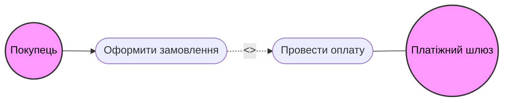

# актори та їхні цілі
Актор 1: Покупець 
    Ціль: вибрати товари та оплатити їх

Актор 2: Платіжний шлюз
    Ціль: отримати запит про оплату та обробити його

# Use Case діаграма за допомогою Mermaid

# сценарії Gherkin
Feature: Оформлення замовлення з оплатою карткою
    Scenario: Оплата карткою пройдена успішно
        Given Користувач авторизований в системі
        And У кошику додано товарів на суму 6767 грн
        And Покупець вибирає оплату через "Банківську картку"
        When Покупець натискає кнопку "Оплата"
        Then Система надсилає запит у платіжний шлюз 
        And Платіжний шлюз підтверджує оплату
        And В базі даних створюється запис про успішну оплату
        And Статус замовлення змінюється на "Оплачено"
        And Покупець отримує сповіщення про успішну оплату

    Scenario: Оплата карткою відхилена через недостаток коштів
        Given Користувач авторизований в системі
        And У кошику додано товарів на суму 6767 грн
        And Покупець вибирає оплату через "Банківську картку"
        When Покупець натискає кнопку "Оплата"
        Then Система надсилає запит у платіжний шлюз 
        And Платіжний шлюз відхиляє оплату через недостатність коштів
        And Статус замовлення залишається "Очікує оплати"
        And Покупець отримує повідомлення про нездійснену оплату 

    Scenario: Оплата карткою відхилена через проблеми з платіжним шлюзом
        Given Користувач авторизований в системі
        And У кошику додано товарів на суму 6767 грн
        And Покупець вибирає оплату через "Банківську картку"
        When Покупець натискає кнопку "Оплата"
        Then Система надсилає запит у платіжний шлюз 
        And Платіжний шлюз не відповідає протягом 30 секунд
        And Статус замовлення залишається "Очікує оплати"
        And Покупець отримує повідомлення про нездійснену оплату