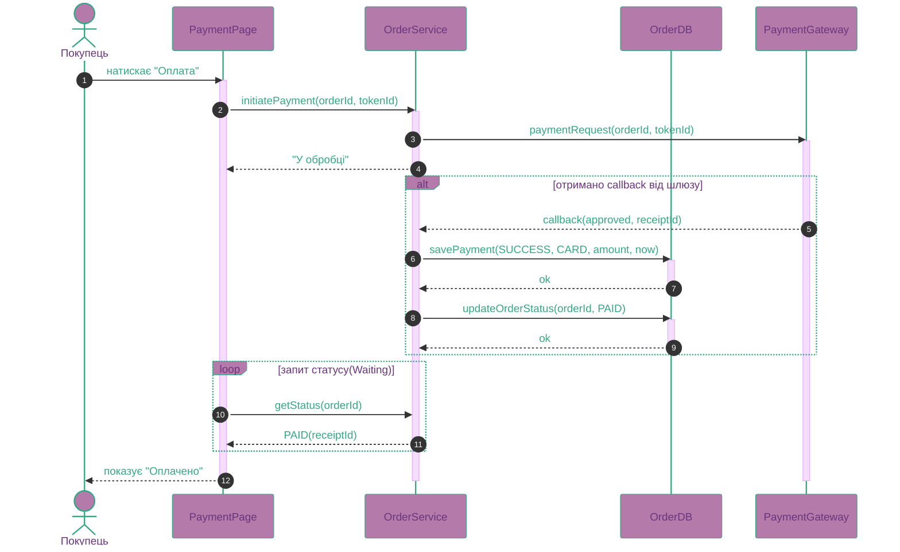
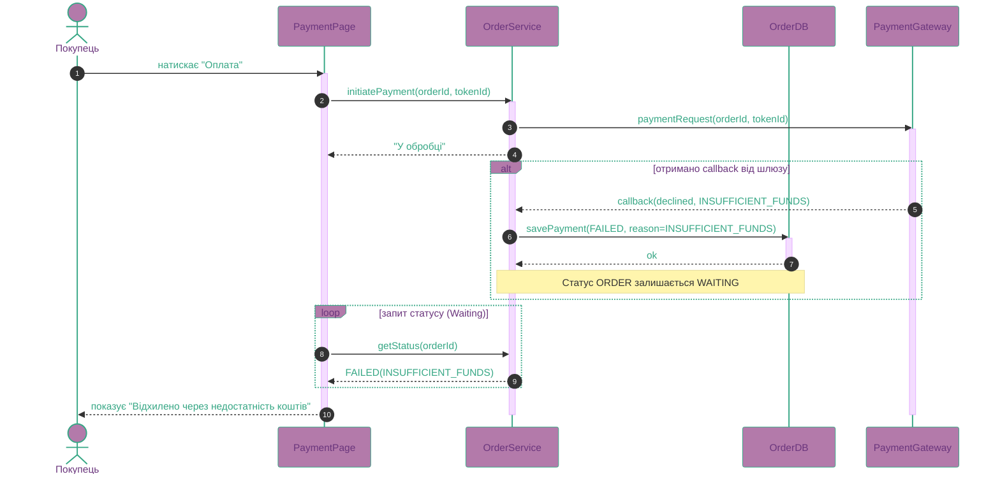

# намір
деталізувати внутрішню взаємодію компонентів системи для кожного сценарію оплати карткою, щоб кожен крок Gherkin відповідав діаграмі та кожен учасник відповідав ER-діаграмі

# критерії прийняття
- для кожного сценарія повинна бути sequence-діаграма
- у кожній діаграмі щонайменше один фрагмент alt/opt/loop
- activation bar починається до alt і закінчується після умовного фрагмента
- кроки кожного сценарію Gherkin покриті
- учасники відповідають сутностям ER-моделі

# учасники

| Учасник | Роль | Відповідність ER-моделі |
| :--- | :--- | :--- |
| PaymentPage | відповідає за інтерфейс користувача | не є сутністю БД |
| OrderService | відповідє за бізнес логіку між даними та інтерфейсом | керує ORDER, ORDER_ITEM, PAYMENT |
| OrderDB | відповідає за запис даних у базу даних | таблиці ORDER, PAYMENT, ORDER_ITEM |
| PaymentGateway | зовнішній учасник який опрацьовує дії з переказами коштів | зовнішній учасник |
| Покупець | користувач, який оплачує замовлення | CUSTOMER |

# кроки сценаріїв

схема кроків:
учасник -> учасник: дія

## сценарій 1 (оплата пройшла успішно)

1. Покупець -> PaymentPage: натискає кнопку "Оплата"
2. PaymentPage -> OrderService: ініціація оплати initiatePayment(orderId, tokenId)
3. OrderService -> PaymentGateway: запит оплати  paymentRequest(orderId, tokenId)
4. OrderService -> PaymentPage: показ статуса "У обробці"
5. PaymentGateway -> OrderService: виклик callback(approved, receiptId)
6. OrderService -> OrderDB: додавання запису через savePayment(status=SUCCESS, method=CARD, amount=SUM(unit_price*quantity), paid_at=now, order_id=orderId)
7. OrderService -> OrderDB: оновлення статусу у базі даних updateOrderStatus(orderId, PAID)
8. PaymentPage -> OrderService: запит статусу getStatus(orderId)    (у циклі поки не отримано фінальний статус)
9. OrderService -> PaymentPage: повернення PAID(receiptId)
10. PaymentPage -> Покупець: показує "Оплачено"

## сценарій 2 (відхилено через недостатність коштів)

1. Покупець -> PaymentPage: натискає кнопку "Оплата"
2. PaymentPage -> OrderService: ініціація оплати initiatePayment(orderId, tokenId)
3. OrderService -> PaymentGateway: запит оплати  paymentRequest(orderId, tokenId)
4. OrderService -> PaymentPage: показ статуса "У обробці"
5. PaymentGateway -> OrderService: виклик callback(declined, INSUFFICIENT_FUNDS)
6. OrderService -> OrderDB: додавання запису через  savePayment(status=FAILED, reason=INSUFFICIENT_FUNDS)
7. PaymentPage -> OrderService: запит статусу getStatus(orderId)
8. OrderService -> PaymentPage: повернення FAILED(INSUFFICIENT_FUNDS) (ORDER.status залишається WAITING)
9. PaymentPage -> Покупець: показує "Відхилено через недостатність коштів"

## сценарій 3 (оплата відхилена через проблеми з платіжним шлюзом/таймаут)
1. Покупець -> PaymentPage: натискає кнопку "Оплата"
2. PaymentPage -> OrderService: ініціація оплати initiatePayment(orderId, tokenId)
3. OrderService -> PaymentGateway: запит оплати  paymentRequest(orderId, tokenId)
4. OrderService -> PaymentPage: показ статуса "У обробці"
5. PaymentGateway (не відповідає 30 секунд)
6. OrderService -> OrderDB: додавання запису через savePayment(status=FAILED, reason=TIMEOUT)
7. PaymentPage -> OrderService: запит статусу getStatus(orderId)
8. OrderService -> PaymentPage: повернення FAILED(TIMEOUT) (статус залишається WAITING)
9. PaymentPage -> Покупець: показує "Платіжний шлюз не відповідає"

# sequance-діаграми

## 1 сценарій

## 2 сценарій

